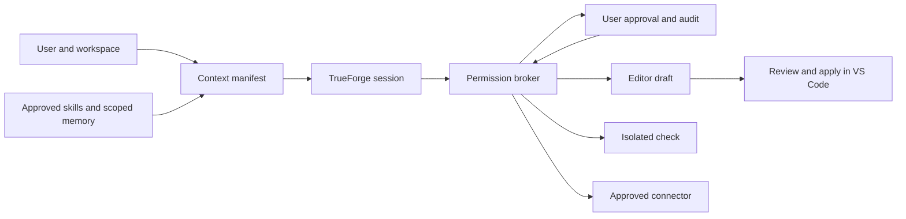

# Claude Cowork research for AgentExtension

**Reviewed 9 November 2026.** This research covers Claude Cowork, the Claude Desktop components that connect it to a device, and selected public Claude Code contracts. The integration sections describe proposed changes to AgentExtension 0.2.0.

## Findings and evidence

- **Shipped evidence** identifies files, code paths, and settings in one Claude Desktop build. It establishes what the package contains.
- **Documented behavior** describes what Anthropic says the product does. Availability can depend on the account, rollout, platform, and administrator policy.
- **Proposed design** describes choices for AgentExtension. Claude Code and the Agent Skills specification offer implementation references where Cowork's internal contract is private.

The first release to build is **a permission broker, followed by skills and a context manifest**. AgentExtension already has two useful control points. It asks for plan approval before edits and checks an exact draft before apply. Give every new capability the same kind of explicit scope before adding connectors, persistent memory, or workers.

## 1. Execution and permissions

### Where Cowork runs

Anthropic documents cloud execution as the default. The agent loop and code run in an isolated environment on Anthropic's servers. Session state and files can follow the account across supported surfaces. Local files and the local browser are reached through the online desktop app over a brokered connection. Each local tool call is checked against the user's scope. Data opened through this bridge can be processed on Anthropic's servers. The cloud runner cannot directly access private network addresses. [Cowork architecture](https://support.claude.com/en/articles/14479288-claude-cowork-architecture-overview) · [Web, desktop, and mobile](https://support.claude.com/en/articles/15520349-use-claude-cowork-on-web-desktop-and-mobile)

Anthropic separately describes existing local sessions. In that model, the desktop host runs the agent loop and enforces folder and network policy. Shell commands run in a Linux VM with separate egress and process controls. The original release used a fuller VM boundary for the agent loop as well. Which local sessions remain available depends on the deployment and migration status. [Cowork architecture](https://support.claude.com/en/articles/14479288-claude-cowork-architecture-overview) · [Containment design history](https://www.anthropic.com/research/how-we-contain-claude)

### Permission layers

| Layer | Documented behavior | Design for AgentExtension |
| --- | --- | --- |
| Workspace and network | Users connect folders. Cloud and local execution have their own network restrictions. The desktop bridge checks local tool calls. [Architecture](https://support.claude.com/en/articles/14479288-claude-cowork-architecture-overview) | Bind each run to a canonical workspace identity. Check path and symlink rules at dispatch. Define network destinations separately from file grants. |
| Action approval | Manual mode prompts on gated actions. Auto mode screens actions. Skip mode removes those approvals and automatic screening. Permanent file deletion still requires a specific approval. [Getting started](https://support.claude.com/en/articles/13345190-get-started-with-claude-cowork) · [Safety](https://support.claude.com/en/articles/13364135-use-claude-cowork-safely) | Keep explicit approvals for applying edits, running commands, and writing to services. Allow reusable read grants only for a named workspace or account. Revoke them from one panel. |
| Computer and browser | Computer use asks for app access. Browser tools ask before first action on a site and apply separate safety checks. Host desktop input operates on the real device. [Computer use](https://support.claude.com/en/articles/14128542-let-claude-use-your-computer-in-cowork) · [Built-in browser](https://support.claude.com/en/articles/16607400-use-the-built-in-browser-in-claude-cowork) | Model the desktop, browser, and terminal as separate capabilities. A grant to run tests cannot authorize browser navigation or desktop input. |
| Connectors | A connector can expose both read and write tools. Authentication, tool permissions, and account scope are distinct. [Remote MCP connectors](https://support.claude.com/en/articles/11175166-get-started-with-custom-connectors-using-remote-mcp) · [Safety](https://support.claude.com/en/articles/13364135-use-claude-cowork-safely) | Show the server, account, tool, target, and effect in approval. Treat tool annotations from a server as descriptive metadata. |
| Organization and device | Admins can control availability, egress, persistent approvals, and trusted-device requirements. Device policy can disable local MCP or desktop extensions. Cowork supports compliance and telemetry surfaces for eligible organizations. [Architecture](https://support.claude.com/en/articles/14479288-claude-cowork-architecture-overview) | Enforce administrator limits before user choices. Log scope and decisions with sensitive arguments redacted. Keep the audit policy separate from model context. |

**Proposed broker.** Describe every action with a tool ID, effect, target, normalized arguments, run ID, and policy version. Check capability scope and explicit denials first. Then require a matching grant or request approval. Bind a one-time grant to the exact action and consume it at dispatch. Bind an edit or check to the draft revision and selected hunks. Cancel grants when the run, identity, tool version, or scope changes. Keep actual filesystem and network checks in the executor.

Claude Code is a separate reference for typed allow, ask, and deny rules, settings precedence, and permission modes. It evaluates matching deny rules before ask and allow rules. A more specific allow rule cannot override a deny. AgentExtension can reuse that rule order and keep its existing approval gates. [Claude Code permissions](https://code.claude.com/docs/en/permissions) · [Settings and precedence](https://code.claude.com/docs/en/settings)

## 2. Skills, MCP, plugins, and hooks

| Component | Cowork and related public contracts | Proposed boundary |
| --- | --- | --- |
| **Skill** | Reusable instructions and resources. Claude supports built-in and uploaded skills. The Agent Skills format uses `SKILL.md` with name and description plus optional supporting files. Metadata supports discovery. The full instructions load when selected, with resources read as needed. [Use skills in Claude](https://support.claude.com/en/articles/12512180-use-skills-in-claude) · [Agent Skills specification](https://agentskills.io/specification) | Index metadata from approved roots. Activate by user selection or a bounded relevance match. Load the selected body and explicit resource files. Skill text can describe a workflow. Each requested action still passes through the broker. |
| **MCP connector** | Remote MCP connects Claude to services. Anthropic documents cloud and local execution differences for plugin connectors. Claude Code documents local, project, and user configurations and on-demand tool discovery. [Remote MCP](https://support.claude.com/en/articles/11175166-get-started-with-custom-connectors-using-remote-mcp) · [Cowork architecture](https://support.claude.com/en/articles/14479288-claude-cowork-architecture-overview) · [Claude Code MCP](https://code.claude.com/docs/en/mcp) | Register connectors explicitly in TrueForge. Start with an allowlist of named read tools. Defer the other schemas. Gate OAuth setup, writes, and auth changes in VS Code. Keep credentials in a credential store. |
| **Plugin** | A bundle of workflow components such as skills, connectors, commands, hooks, and subagents. Claude provides a catalog and supports custom and organization-shared plugins. Component availability varies by surface. [Use plugins](https://support.claude.com/en/articles/13837440-use-plugins-in-claude) · [Plugins page](https://support.claude.com/en/articles/17740565-manage-plugins-skills-and-connectors-from-one-plugins-page) | Use a declarative manifest with ID, publisher, version, capabilities, and pinned content digest. Show requested capabilities before enabling. Expose commands as namespaced shortcuts to reviewed workflows. |
| **Hook** | Claude Code supports event-driven hooks for deterministic actions such as validation and tool-call blocking. Claude's plugin documentation describes hooks in Cowork. [Claude plugins](https://support.claude.com/en/articles/13837440-use-plugins-in-claude) · [Claude Code hooks](https://code.claude.com/docs/en/hooks) | Start with first-party hooks that publish events or reject invalid actions. Run custom hook code only in a separately approved executor with a bounded input, time, and output. |
| **Distribution** | Claude documents organization provisioning, sharing, and plugin customization. Claude Code documents plugin manifests and versioned components. [Organization skills](https://support.claude.com/en/articles/13119606-provision-and-manage-skills-for-your-organization) · [Plugin manifest](https://code.claude.com/docs/en/plugins-reference) | Keep install and enable separate. Validate archive paths, symlinks, sizes, and manifest fields before unpacking. Require new approval when an update changes effects or endpoints. |

For the first version, a plugin can point to a skill and an already approved connector. Keep its scripts and hooks disabled until the command sandbox and effect policy support them. A command that runs a skill and a connector should expand to the same brokered actions as a direct request. The [MCP tools specification](https://modelcontextprotocol.io/specification/latest/server/tools) defines discovery and invocation. The host must supply its own authorization.

Anthropic's public Cowork plugin examples provide a concrete layout. `.claude-plugin/plugin.json` identifies the bundle, `skills/<name>/SKILL.md` defines workflows, `agents/*.md` defines workers, and `.mcp.json` registers connectors. Hook configuration and legacy command files are optional. Public Claude Code skills also support explicit-only invocation and isolated execution with `context: fork`. For AgentExtension, these are candidates for a restricted import format. Accept skill metadata and text first, with explicit-only workflows hidden from automatic selection. Review connector and hook declarations separately. [Cowork plugin examples](https://github.com/anthropics/knowledge-work-plugins) · [Component schemas](https://github.com/anthropics/knowledge-work-plugins/blob/main/cowork-plugin-management/skills/create-cowork-plugin/references/component-schemas.md) · [Claude Code skills](https://code.claude.com/docs/en/skills)

## 3. System prompt, memory, and context

### Instructions and their authority

Cowork documents account-wide instructions, project instructions and files, and folder instructions when a local folder is selected. The unified experience moves the previous Cowork global instructions into the shared Claude personalization settings. These settings show where users can supply guidance. The exact Cowork system prompt, server-side injection order, and internal routing thresholds remain unresolved. [Cowork instructions](https://support.claude.com/en/articles/13345190-get-started-with-claude-cowork) · [Unified experience](https://support.claude.com/en/articles/16761823-claude-cowork-and-chat-are-one-claude)

Claude Code publicly exposes a different interface. Its CLI documents `--system-prompt` and `--append-system-prompt` with file-based variants. Repository guidance can come from `CLAUDE.md` and path-scoped rules. The `/context` and `/memory` tools help users inspect context and memory. These interfaces provide a design reference for transparency. [CLI reference](https://code.claude.com/docs/en/cli-reference) · [Project memory and rules](https://code.claude.com/docs/en/memory) · [Context and agent loop](https://code.claude.com/docs/en/how-claude-code-works)

### Context distribution

| Context source | Public behavior or proposed treatment |
| --- | --- |
| Runtime instructions | AgentExtension already sends a checked-in TrueForge agent definition. Keep this policy-owned and versioned. Publish its identity in the run trace. |
| User and workspace instructions | Let users opt into a user profile and one workspace profile. Use explicit labels and origins. Render the user's current request separately from file excerpts and tool results. |
| Memory | Cowork in the cloud can share account memory with chat. Cowork projects have project memory and a control to exclude account memory. Claude Code distinguishes human-written instructions from automatically saved project notes. [Cowork projects](https://support.claude.com/en/articles/14116274-organize-your-tasks-with-projects-in-claude-cowork) · [Claude Code memory](https://code.claude.com/docs/en/memory) |
| Skills and tool schemas | Claude Code documents progressively loaded skills and deferred MCP schemas. Its memory docs distinguish a small startup index from notes read later. [Extend Claude Code](https://code.claude.com/docs/en/features-overview) · [Project memory](https://code.claude.com/docs/en/memory) |
| Session history and tool output | Claude Code documents context growth and compaction. AgentExtension already retrieves bounded excerpts and can disable TrueForge compaction for an incompatible model. Keep recent decisions, draft IDs, and approvals in host state with explicit recovery rules. [Claude Code agent loop](https://code.claude.com/docs/en/how-claude-code-works) |
| Worker context | Send the worker its task, required files or excerpts, capability subset, limits, and expected result. Keep unrelated chat history, account memory, and existing grants out of the worker input by default. This is a proposed AgentExtension rule. |

**Proposed context manifest.** Show which prompt sources entered a run. Record source kind, scope, source ID, trust class, revision, and estimated size. Preserve the user's current goal and approved plan across compaction. Store permissions and draft state outside summaries. Use separate budgets for instructions, selected skills, source excerpts, tool schemas, and retained outputs. Resolve references lazily and show truncation. Treat tool outputs, web pages, files, and memory claims as data. A memory entry can influence a response only within its scope.

**Proposed memory.** Start with local, editable workspace notes that a user can save and delete. Store each note with its scope, origin, timestamp, and source reference. Separate user-approved notes from temporary model suggestions. Recheck visibility at retrieval. Keep session state, workspace memory, and optional account preferences in different stores. On fallback, carry forward the task and eligible context while resetting draft-specific approvals.

## 4. Browser and computer use

Anthropic documents an order of preference for Cowork. Use a direct connector when available, then an approved browser, then screen interaction when the task needs it. The built-in browser runs through the desktop app and can be used instead of Claude in Chrome. Browser and desktop availability depend on the account and policy. Desktop screen interaction needs an online device, and per-app permission grants govern access. Anthropic describes background window interaction on supported macOS versions and full-control settings. [Computer use](https://support.claude.com/en/articles/14128542-let-claude-use-your-computer-in-cowork) · [Built-in browser](https://support.claude.com/en/articles/16607400-use-the-built-in-browser-in-claude-cowork)

For AgentExtension, use the VS Code API for editor operations and a purpose-built connector for structured services. Add browser inspection later in a dedicated profile with an origin allowlist and read-only operations first. Use per-action approval for navigation outside scope, form submission, file upload, and other writes. Capture a small screenshot or semantic result as evidence when useful. Treat page text and images as untrusted input. Design native computer control as a separate, opt-in capability with a visible stop action and app identity checks.

## 5. Subagents and parallel work

Cowork documents coordination of parallel workstreams and plugin-bundled subagents. The desktop package and public help pages do not settle the cloud scheduler, child prompt layout, inheritance rules, or write-conflict handling. Claude Code separately documents custom subagent frontmatter, role prompts, tool restrictions, model and permission settings, skills, hooks, memory, and worktree isolation options. Claude Code's child context model is a reference for the design below. [Install Claude Desktop](https://support.claude.com/en/articles/10065433-install-claude-desktop) · [Cowork plugins](https://support.claude.com/en/articles/13837440-use-plugins-in-claude) · [Claude Code subagents](https://code.claude.com/docs/en/sub-agents)

Start with named read-only workers for repository research, test diagnosis, and diff review. Set tool limits, token budgets, and cancellation deadlines per worker. Give each worker only the necessary input and collect structured findings with file references. Keep the parent responsible for draft mutations and approval. For later write workers, use independent draft branches with base revisions and explicit merge review. Reject stale or overlapping proposals. The parent can grant only a subset of its own capabilities, and user approvals remain bound to the original action.

## 6. Other product facilities

| Facility | Documented behavior | Fit for AgentExtension |
| --- | --- | --- |
| Cross-device sessions | Cloud sessions can continue across supported desktop, web, and mobile surfaces. A device-dependent step needs the relevant desktop app online. [Surfaces](https://support.claude.com/en/articles/15520349-use-claude-cowork-on-web-desktop-and-mobile) | Save resumable run metadata and checkpoints locally before considering cross-device control. |
| Projects and sharing | Projects keep instructions, files, and memory for related work. Eligible organizations can share project access with view or edit roles. [Projects](https://support.claude.com/en/articles/14116274-organize-your-tasks-with-projects-in-claude-cowork) | Use the workspace as the first project boundary. Add explicit sharing only if a backend can enforce it. |
| Artifacts and office files | Claude can create editable artifacts and generate deliverables such as documents, slides, spreadsheets, dashboards, and small interactive tools. The current artifact experience differs from older desktop-only live artifacts. [Artifacts](https://support.claude.com/en/articles/17153992-what-are-artifacts-and-how-do-i-use-them) · [Live artifact migration](https://support.claude.com/en/articles/14729249-use-live-artifacts-in-claude-cowork) | Extend the plan and verification panels into durable Markdown run reports with links to diffs and checks. |
| Scheduled tasks | Users define instructions and cadence, confirm creation, and manage past or upcoming runs. Cloud scheduling can run without the computer. Device-dependent tasks have a local execution requirement. [Scheduled tasks](https://support.claude.com/en/articles/13854387-schedule-recurring-tasks-in-claude-cowork) | Later, let users schedule read-only reports with explicit time zone, budget, permissions, and a run log. Require fresh approval for any write. |
| Dispatch | Anthropic documents task assignment from a phone for existing Dispatch users. Its unified experience page says Dispatch is unavailable to new users. [Dispatch](https://support.claude.com/en/articles/13947068-assign-tasks-from-anywhere-in-claude-cowork) · [Unified experience](https://support.claude.com/en/articles/16761823-claude-cowork-and-chat-are-one-claude) | Defer remote control until device trust, revocation, and offline recovery are available. |
| User questions and task progress | Cowork can ask structured questions while setting up tasks, show work in progress, and let the user stop a task. [Getting started](https://support.claude.com/en/articles/13345190-get-started-with-claude-cowork) · [Scheduling](https://support.claude.com/en/articles/13854387-schedule-recurring-tasks-in-claude-cowork) | Add a structured pause that explains why an input is needed. Keep existing streaming activity and show pending approvals beside it. |
| Admin, usage, and audit | Anthropic documents organization policy, Compliance API and OTel coverage for supported deployments, and plan usage for agentic work. [Architecture](https://support.claude.com/en/articles/14479288-claude-cowork-architecture-overview) · [Unified experience](https://support.claude.com/en/articles/16761823-claude-cowork-and-chat-are-one-claude) | Start with a local audit trail that records effects, grants, and outcomes. Add an export with redaction and separate token, time, and call budgets. |

## 7. Integration plan

AgentExtension already has a per-run editor MCP connector, tool allowlists, deferred discovery, bounded retrieval, plan approval, revision-bound commands, a per-hunk apply gate, and undo. Its checked-in TrueForge agent spec disables dynamic subagents and leaves memory, skills, and general-purpose connector configuration outside the current workflow. The pinned SDK exposes fields for agent skills, memory configuration, MCP selectors, and dynamic subagents. Check the pinned TrueForge server's actual behavior before exposing those fields in the UI. [Agent spec](../trueforge/agent.json) · [Bridge](../src/bridge.js) · [TrueForge client](../src/forge.js) · [Workspace executor](../src/workspace.js)

The SDK describes its sandbox as a prerequisite for TrueForge-managed skills. The current spec disables that sandbox and uses an editor-managed workspace copy for commands. Start with text-only skill loading in the extension, or verify TrueForge's sandbox and skill storage together before using its native skill runner. Keep the broker in front of both routes.

| Order | Deliverable | Acceptance checks |
| --- | --- | --- |
| **1** | Add a shared permission broker to the bridge and TrueForge approval handler. Keep exact command, draft, and review checks. Add a read scope and a local decision log. | Expired, revoked, cross-workspace, and changed-target grants fail before side effects. Cancel and retry clear one-time approvals. Existing review and undo pass. |
| **2** | Add an allowlisted `SKILL.md` registry and visible context manifest. Separate instructions, repository excerpts, tool results, and memory in the prompt composer. | Metadata stays small. Only a selected body and requested resources load. Untrusted content cannot expand permissions. A restart or compaction preserves the host's approval state. |
| **3** | Add user-approved workspace memory and read-only MCP connectors. Keep account and workspace identifiers distinct. | A connector token stays out of prompts and logs. Tool and resource scope applies before and after authentication. Revocation blocks the next request. Notes from workspace A never appear in B. |
| **4** | Add versioned plugin manifests and two bounded workers for repository research and diff review. Keep the existing parent apply gate. | A plugin update that adds an effect requires review. Workers cannot inherit edit or connector-write permission. Cancellation reaches every child. Conflicting proposals cannot modify disk. |
| **5** | Add browser inspection and durable run reports. Consider scheduling and native computer use after those controls pass. | Browser observation stays within approved origins. A write or upload needs action approval. A report links to the exact checked draft and distinguishes passed, failed, skipped, and stale checks. |

Use real TrueForge sessions with a scripted model to test authorization, pause, cancellation, retry, and rollback deterministically. Run a second suite with a compatible live model for task quality and tool selection. The previous Flask Task B fixture passed editor and CLI checks. A live model pass is still an acceptance test for future changes.

## 8. Shipped artifact evidence

### Build identity and limits

The package reports **Claude Desktop 4.23118.0** for macOS. The bundle identifier is `com.anthropic.claudefordesktop`. The disk image was opened read-only. The investigation used static inspection of the app, helpers, and skill assets, plus public documentation. [Inspected release image](https://downloads.claude.ai/releases/darwin/universal/4.23118.0/Claude-8175c354eda704cea00fdeddfa69cea329dd321a.dmg)

| Input | SHA-256 |
| --- | --- |
| `Claude.dmg` | `0e3d86a8b7ac6d7e6a3de011134db1717716fa6ecbe323f5ea4a5356fba62810` |
| `Contents/Resources/app.asar` | `4a47424bf89ffe2041ff5828da635d366485599ef2823ee1ce2e8e10dce7903f` |
| `Contents/Resources/ion-dist.asar` | `fe3dab2e327b043878176ed4b354eda6213055b5bc9270e0cfebf0748362f9d3` |

REA recorded eight contradictions between ASAR hash declarations and unpacked native files, including the computer-use binding and the GitHub MCP executable. macOS `codesign --verify --strict` also rejected the bundle signature. The cause remains unknown. REA retained the desktop archive analysis with `integrity_policy: "record-and-continue"`. The selected packed JavaScript and root manifest matched their internal ASAR SHA-256 declarations. These checks establish byte consistency within the archive. Publisher authenticity was unverified.

| REA scope | Retained parent evidence |
| --- | --- |
| Desktop MCP, plugin discovery, prompt, consent renderer, computer use, and artifact paths | `ev_60a374b59ea10cb0bd155928da862c0c3a7ff2ccc484d0b9e4ee60d1b1d83b6f` |
| Desktop consent preload, local MCP policy, memory, migration, and artifact permission helpers | `ev_59d73b50d0db3fa91a59e2a5b5c652bc2b71bde8846ab89595508a1a6c7d846d` |
| Renderer settings, marketplace, context meter, subagent display, and computer-use capability state | `ev_70fd09f97486d1488a22306f47ca3c54dff1b1a76b8d952dd5f7934ca346d934` |
| Renderer memory, local browser switching, and task UI helpers | `ev_325c9a59beb25b78eba1fc80e4f7da14fb6ef90bfe73201c89ca5ab8558428b9` |
| Two focused host excerpts for prompt section rendering and memory guidance | `ev_60b7924eb6c2e98ed5c0fb6a9a0a8b5cfd63877530cfdb7e94615236781d9b5e` |

### Selected static findings

Offsets below are zero-based byte offsets within the named member. A finding establishes the presence of a code path or asset. The runtime conditions that activate it remain outside this inspection.

| Area | Observed in this build | Location |
| --- | --- | --- |
| Local consent and policy | An Electron preload exposes a consent bridge. The renderer wires allow and cancel actions. A separate host function checks the local-development MCP policy flag. These are distinct from the cloud approval modes described by Anthropic. | `app.asar` → `.vite/build/localExecConsent.js` at 947, `.vite/renderer/local_exec_consent/assets/main-HS4c_Lfo.js` at 1257 and 5071, `.vite/build/index.chunk-yUgyECCM.js` at 4206 |
| Skills and plugins | The discovery path reads bounded plugin and MCP manifests and limits skill probes. The archive contains bundled DOCX, PDF, PDF reading, PPTX, XLSX, and frontend design skills. The sampled XLSX bundle includes a skill file, scripts, and schemas. The sampled frontend design bundle contains a skill file and license. | `app.asar` → `.vite/build/index.chunk-2uIHehAa.js` at 882, 3678, and 3809, plus `resources/bundled-skills/` |
| MCP routing | A direct connector path publishes tool identity and read-only hints, checks availability at dispatch, and distinguishes an authentication failure. A Node host accepts initialization over a process message port. These modules establish local machinery. The unpacked executables were excluded from behavioral conclusions. | `app.asar` → `.vite/build/index.chunk-D_4AJHfY.js` at 2249, 2546, and 3021, `.vite/build/mcp-runtime/nodeHost.js` at 14298 |
| Prompt composition | A helper adds a fragment to a Claude Code preset, custom prompt, or existing append field. It also has a separate subagent append. Another helper substitutes named variables and conditional sections. A session startup path handles renderer appends alongside an account and organization check. The full Cowork cloud prompt remains unknown. | `app.asar` → `.vite/build/index.chunk-BNqFC_Dr.js` at 1379 and 1803, `.vite/build/index.chunk-3LhJpb-O.js` at 3733, `.vite/build/index.chunk-CAJ_Jr0j.js` at 14650, `.vite/build/index.chunk-BBUaTQ8d.js` at 6201435–6201849 |
| Memory and context | A local-session path records a baseline hash when seeding a `CLAUDE.md` file. A memory helper can append guidance to the main and child prompts. The renderer parses memory frontmatter and derives displayed token and window values. The cloud memory store and ranking algorithm remain unknown. | `app.asar` → `.vite/build/index.chunk-CAJ_Jr0j.js` at 18108, `.vite/build/index.chunk-D6Y0BUdo.js` at 95450–96169. `ion-dist.asar` → `assets/v1/c95fcb9b2-DTQgkD7O.js` at 909, `assets/v1/c146b936d-Dx7LvC1G.js` at 962 and 1686 |
| Computer and browser use | Packaged preloads expose teach and recording-related IPC. The renderer distinguishes computer-use support and OS permissions, and checks for a browser switch tool. These are static feature surfaces with separate eligibility. | `app.asar` → `.vite/build/computerUseTeach.js` at 950 and 3637, `.vite/build/computerUseWatchRecord.js` at 3637. `ion-dist.asar` → `assets/v1/cd55d696d-CSVWO8np.js` at 729 and 897, `assets/v1/c17c38211-DeLCif3j.js` at 1271 |
| Subagents | The renderer recognizes a subagent marker when grouping tool-use blocks. The host prompt helper has a separate subagent append. The dispatch rules, context inheritance, and write isolation of Cowork's cloud workers remain unresolved. | `ion-dist.asar` → `assets/v1/ca5fba05a-CrtqJRIM.js` at 2212. `app.asar` → `.vite/build/index.chunk-BNqFC_Dr.js` at 1803 |
| Artifacts and scheduled tasks | A Cowork artifact preload forwards tool, assistant, and external-link requests through IPC. A local migration reader handles scheduled task and artifact records. These paths show desktop capabilities and migration support. Current cloud scheduling and artifact behavior come from the public docs. | `app.asar` → `.vite/build/coworkArtifact.js` at 771, 861, and 1135, `.vite/build/index.chunk-Cb8Par3o.js` at 4061 |

To reproduce, acquire the same release image and verify its digest. Use REA's JavaScript application analyzer on each ASAR with `detail: "summary"` and the exact member paths for the question. Inspect retained modules for the selected paths. The two focused prompt excerpts use end-exclusive byte ranges from packed members that matched their declared hashes. The host and renderer scopes are partial. Runtime approvals, the full cloud prompt, context selection, and worker inheritance need separate observations.
